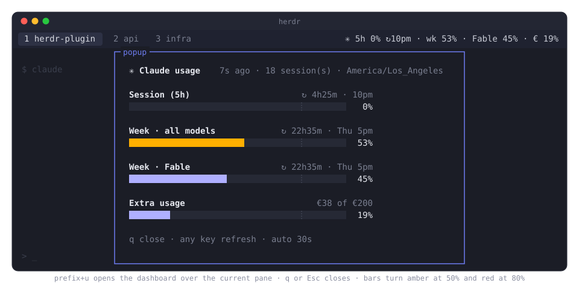

<div align="center">

# herdr-claude-usage

**Your Claude Code usage limits in the [Herdr](https://herdr.dev) tab bar. One number per window, visible from every pane.**


</div>

## What you get

The tab bar shows the session window with its reset hour, the week, the weekly window of each model that has one, and the monthly extra-usage credits. A percentage above 80 gets a `!!` suffix. A trailing `+` means a second signed-in profile is active too.

`prefix+u` opens a popup with the same numbers as bars. Each bar has a tick where red begins, a reset countdown (`↻ 33m · 8pm`), and the extra-usage row shows the spend in money. Below the bars: the active session count and one line per other signed-in profile. Any key refreshes, the popup refreshes itself every 30s, `q` or `Esc` closes.

Sessions signed into different accounts show up as separate profiles. The logged-in account is primary. The others get one line each, so a second account never takes over the display.

## Installation

Requirements: Herdr 0.8+, `bash`, `jq`, `curl`. macOS or Linux.

```sh
herdr plugin install aodanchenko/herdr-claude-usage
herdr plugin action invoke herdr-claude-usage.configure
```

That is the whole setup. `configure` does three things. It wraps the `statusLine` in `~/.claude/settings.json`, after backing the file up, and chains to whatever command was there. It writes the tab-bar entry and the `prefix+u` keybinding into Herdr's `config.toml`, also backed up, and rolls the edit back if Herdr rejects the result. Then it reloads the server. Numbers appear within a minute of any Claude Code session running.

Herdr's plugin manifest cannot declare tab-bar entries or keybindings, so a configure step has to exist. I would rather it did not. If you manage `config.toml` yourself, skip the parts you own. `configure` never touches an existing `tab_bar_right` and prints the entry for you to paste instead.

<details>
<summary>Manual setup (what configure writes)</summary>

```toml
[ui]
tab_bar_right = [
  { type = "command", command = "bash /path/to/herdr-claude-usage/bin/herdr-claude-usage bar", interval_seconds = 30, timeout_seconds = 5 },
]

[[keys.command]]
key = "prefix+u"
type = "popup"
command = "bash /path/to/herdr-claude-usage/bin/herdr-claude-usage dashboard"
width = 64
height = 20
```

Then `herdr server reload-config`.
</details>

## Usage

The tab bar updates on its own every 30s. `prefix+u` opens the dashboard:



Bars are lavender below 50%, amber from 50%, red from 80%. The faint `┊` tick marks where red begins.

## Configuration

Optional `config` file in the plugin config dir (`herdr plugin config-dir herdr-claude-usage`), shell syntax. The same variables work as environment overrides.

```sh
USE_API=1        # 0 disables the OAuth usage API fetch
BAR_HOT=80       # tab-bar '!!' suffix and dashboard red above this
BAR_WARN=50      # dashboard amber from this
STALE_SECS=1800  # how long a profile counts as fresh
```

## How it works, and what it touches

The numbers come from Claude Code itself. Claude Code already calls a `statusLine` command with a JSON payload on stdin, and that payload includes `rate_limits`. The plugin's `collect` command records the payload and passes stdin and stdout through to whatever statusLine command you had before. No login, no token, no network. This is the whole plugin on Linux.

The optional part is the usage API fetch, macOS only. Per-model weekly windows (Fable, for example) and extra-usage spend exist only in the official usage endpoint. To get them, the plugin reads your own Claude Code OAuth token from the macOS keychain, which asks you once, and calls the endpoint at most every 5 minutes. A failed call is not retried until the next window. The token stays in the process. Only the usage JSON is cached on disk. Set `USE_API=0` and this part never runs.

Sessions signed into different accounts or organizations report different limits, so the plugin groups payloads into profiles by their weekly reset time. The profile whose weekly reset matches the usage API response is the logged-in account and becomes primary. Without API data, the profile with the most active sessions wins. A profile quiet for 30 minutes drops out of the display.

One quirk worth knowing. Claude Code sometimes leaves the `five_hour` window out of a payload. The plugin keeps the previous unexpired window instead of blanking the number. Once that window has expired, the displays show `5h 0%`.

## Commands

| Command | Purpose |
| --- | --- |
| `collect` | statusLine hook (invoked by Claude Code; records the payload, chains onward) |
| `bar` | one-line tab-bar summary |
| `dashboard` | interactive popup with bars |
| `draw` | one-shot render (debugging) |
| `configure` / `uninstall` | install or remove the statusLine wrapper and config lines |

## Troubleshooting

- **Tab bar shows `✳ Claude —`.** No Claude Code session has reported for 30 minutes. Use any session and the numbers land within a minute.
- **No Fable or extra-usage entries.** The usage API needs the macOS keychain. Approve the keychain prompt on the first fetch, and check that `USE_API` is not `0`. On Linux these entries do not exist.
- **A keychain dialog appeared.** That is the first usage-API fetch reading your own Claude Code OAuth token. "Always Allow" stops it from asking again.
- **The tab bar has no colors.** Expected. Herdr renders the tab bar without ANSI colors, so `!!` above 80 is the only marker there. The dashboard has the colors.

## Uninstall

```sh
herdr plugin action invoke herdr-claude-usage.uninstall
herdr plugin uninstall herdr-claude-usage
```

The uninstall action restores the previous statusLine and removes every `config.toml` line the plugin added. They all carry a `# herdr-claude-usage` marker.
