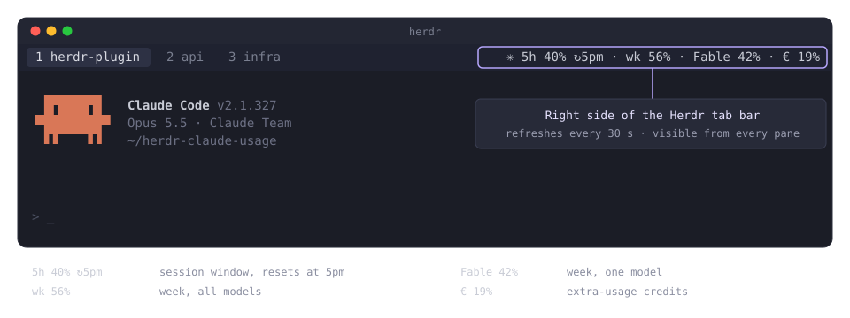

<div align="center">

# herdr-claude-usage

**Claude Code usage limits in the [Herdr](https://herdr.dev) tab bar. Visible from every pane.**



</div>

Claude Code shows your limits in `/usage`, one session at a time. This plugin keeps them in the Herdr tab bar from every pane, and one key opens the details.

## Install
```sh
herdr plugin install aodanchenko/herdr-claude-usage
herdr plugin action invoke herdr-claude-usage.configure
```

Needs Herdr 0.8+, bash, jq, curl. Numbers appear within a minute of any Claude Code session running.

## What you get
**status bar as shown above.** 
!! after a number means over 80%. + at the end means a second account is active too.

prefix+u opens the dashboard: the same numbers as bars, with reset countdowns and the spend in money. q or Esc closes it. 
<div align="center">

</div>

## Is it safe? 
Yes. Claude Code already sends its usage numbers to a statusLine command. The plugin records that payload and passes it on to whatever statusLine you had. **No login, no token, no network.**

The per-model and credit numbers need one optional call to the usage API, macOS only. It reads your own Claude Code token from the keychain (you approve once), calls the endpoint at most every 5 minutes, and caches only the JSON. USE_API=0 turns it off.

Everything is reversible. uninstall restores your old statusLine and removes every config line the plugin added.

## Uninstall

```sh
herdr plugin action invoke herdr-claude-usage.uninstall
herdr plugin uninstall herdr-claude-usage
```

The uninstall action restores the previous statusLine and removes every `config.toml` line the plugin added. They all carry a `# herdr-claude-usage` marker.
